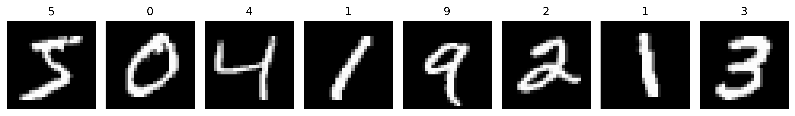
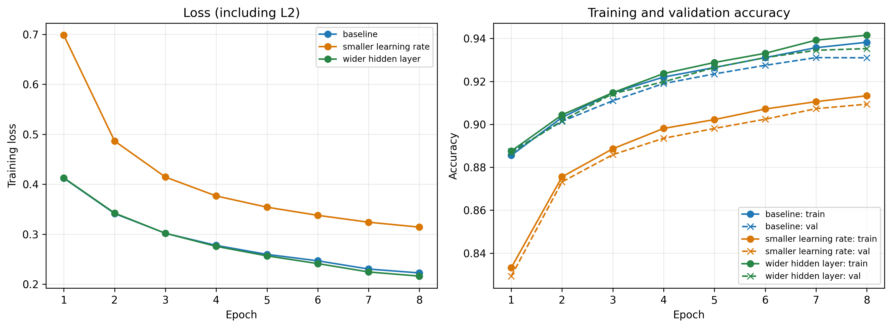

# Homework X2: MLP for MNIST Classification

**Name:** 陈一铭  
**Student ID:** 2024012657  
**Course:** Introduction to Deep Learning

## Honor Code: Use of AI

I used ChatGPT to help derive backpropagation, write and check the NumPy code, run the experiments, and draft this report. It also helped organize the file paths, save figures and experiment records, and convert the Markdown report into LaTeX and PDF. The reported numbers come from the executed notebook and its saved records. The supplied data split, seed, objective, and implementation rules were kept. I remain responsible for understanding the code, checking the results, and following the course rules on independent work and AI assistance.

## 1. Aim and Experimental Setup

In this homework, I extended the linear MNIST classifier to an MLP with one ReLU hidden layer. The model uses softmax probabilities, mean cross-entropy loss, L2 regularization, and mini-batch SGD. All model calculations and updates use NumPy.

I flattened each 28 by 28 image into 784 features and divided the pixel values by 255. The input arrays and trained parameters use `float32`; the finite-difference checker uses `float64` parameters.

| Setting | Value |
| --- | --- |
| Training / validation / test | 50,000 / 10,000 / 10,000 images |
| Random seed | 2026 for split, initialization, and shuffling |
| Initialization | Gaussian weights: standard deviations $\sqrt{2/784}$ for $W_1$ and $\sqrt{1/H}$ for $W_2$; zero biases |
| Training epochs / mini-batch size | 8 / 256 for every configuration |
| Regularization | $\lambda=10^{-4}$ on both weight matrices only |
| Model selection | Highest validation accuracy at the final epoch |

I used `default_rng(2026).permutation(60000)`, taking the first 50,000 indices for training and the last 10,000 for validation. Each run started a new model and used the same shuffling seed. For the learning-rate comparison, the width and initialization were identical. Only training examples entered parameter updates. The test set was evaluated once after selecting the configuration by validation accuracy.

*Figure 1. The first eight images from the original MNIST training set, with their labels.*

## 2. Model, Loss, and Gradient Derivation

### 2.1 Notation and Forward Pass

I use bold uppercase letters for matrices and bold lowercase letters for vectors. Scalar entries are not bold. Let $B$ be the batch size, $D=784$ the input size, $H$ the hidden-layer width, and $C=10$ the number of classes. The parameter shapes follow the supplied notebook:
$$
\boldsymbol{W}_1\in\mathbb{R}^{H\times D},\quad
\boldsymbol{b}_1\in\mathbb{R}^{H},\quad
\boldsymbol{W}_2\in\mathbb{R}^{C\times H},\quad
\boldsymbol{b}_2\in\mathbb{R}^{C}
$$
For $\boldsymbol{X}\in\mathbb{R}^{B\times D}$, the forward pass is
$$
\begin{aligned}
\boldsymbol{A}&=\boldsymbol{X}\boldsymbol{W}_1^\top+\boldsymbol{1}\boldsymbol{b}_1^\top,
&\boldsymbol{Q}&=\max(0,\boldsymbol{A})\in\mathbb{R}^{B\times H}\\
\boldsymbol{Z}&=\boldsymbol{Q}\boldsymbol{W}_2^\top+\boldsymbol{1}\boldsymbol{b}_2^\top,
&P_{ik}&=\frac{\exp(Z_{ik})}{\sum_{j=0}^{C-1}\exp(Z_{ij})}
\end{aligned}
$$
Here $\boldsymbol{1}\in\mathbb{R}^{B}$ is a vector of ones, and $\boldsymbol{Z},\boldsymbol{P}\in\mathbb{R}^{B\times C}$. Biases are broadcast across rows in code. Define one-hot labels by $Y_{ik}=1$ when $k=y_i$ and 0 otherwise, so $\sum_kY_{ik}=1$.

### 2.2 Objective and Numerical Stability

The batch objective is
$$
L=E+\frac{\lambda}{2}\left(\lVert\boldsymbol{W}_1\rVert_F^2+
\lVert\boldsymbol{W}_2\rVert_F^2\right),\qquad
E=-\frac{1}{B}\sum_{i=1}^{B}\log P_{i,y_i}
$$
The biases are not regularized. The penalty is not divided by $B$.

For row $i$, let $m_i=\max_jZ_{ij}$ and $S_{ik}=Z_{ik}-m_i$. The common factor cancels, so
$$
\frac{\exp(Z_{ik}-m_i)}{\sum_j\exp(Z_{ij}-m_i)}
=\frac{\exp(-m_i)\exp(Z_{ik})}{\exp(-m_i)\sum_j\exp(Z_{ij})}
=P_{ik}
$$
For finite logits, every shifted logit is nonpositive and at least one is zero. Thus exponentiation cannot overflow and the denominator is at least 1. A small probability can still round to zero, so I compute the negative log probability directly:
$$
-\log P_{i,y_i}=\log\sum_{j=0}^{C-1}\exp(S_{ij})-S_{i,y_i}
$$
This avoids taking `log(0)` without clipping probabilities or changing the objective.

### 2.3 Output-Layer Gradients

For one image, $E_i=-\sum_kY_{ik}\log P_{ik}$. Using the softmax derivative gives
$$
\begin{aligned}
\frac{\partial P_{ik}}{\partial Z_{ij}}&=P_{ik}(\delta_{kj}-P_{ij})\\
\frac{\partial E_i}{\partial Z_{ij}}
&=-\sum_kY_{ik}(\delta_{kj}-P_{ij})
=-Y_{ij}+P_{ij}\sum_kY_{ik}=P_{ij}-Y_{ij}
\end{aligned}
$$
Define the averaged output gradient
$$
\boldsymbol{G}=\frac{\partial L}{\partial\boldsymbol{Z}}
=\frac{\boldsymbol{P}-\boldsymbol{Y}}{B}\in\mathbb{R}^{B\times C}
$$
Since $Z_{ik}=\sum_hQ_{ih}(W_2)_{kh}+(b_2)_k$, the scalar derivatives are
$$
\frac{\partial L}{\partial(W_2)_{kh}}=\sum_iG_{ik}Q_{ih}+\lambda(W_2)_{kh},\qquad
\frac{\partial L}{\partial(b_2)_k}=\sum_iG_{ik}
$$
Therefore,
$$
\boxed{\nabla_{\boldsymbol{W}_2}L=\boldsymbol{G}^\top\boldsymbol{Q}+\lambda\boldsymbol{W}_2}
\in\mathbb{R}^{C\times H},\qquad
\boxed{\nabla_{\boldsymbol{b}_2}L=\boldsymbol{G}^\top\boldsymbol{1}}
\in\mathbb{R}^{C}
$$

### 2.4 Hidden-Layer Gradients and ReLU Mask

The gradient with respect to hidden activations is
$$
\frac{\partial L}{\partial\boldsymbol{Q}}=\boldsymbol{G}\boldsymbol{W}_2
\in\mathbb{R}^{B\times H}
$$
For $Q_{ih}=\max(0,A_{ih})$, define $M_{ih}=1$ if $A_{ih}>0$ and 0 otherwise. I use derivative 0 at exactly zero, as required. By the chain rule,
$$
R_{ih}=\frac{\partial L}{\partial A_{ih}}
=\left(\sum_kG_{ik}(W_2)_{kh}\right)M_{ih},\qquad
\boldsymbol{R}=(\boldsymbol{G}\boldsymbol{W}_2)\odot\boldsymbol{M}
\in\mathbb{R}^{B\times H}
$$
The mask passes the gradient through positive preactivations and blocks the data-loss gradient through nonpositive ones. An inactive unit's weights can still receive the L2 gradient.

Since $A_{ih}=\sum_dX_{id}(W_1)_{hd}+(b_1)_h$,
$$
\frac{\partial L}{\partial(W_1)_{hd}}=\sum_iR_{ih}X_{id}+\lambda(W_1)_{hd},\qquad
\frac{\partial L}{\partial(b_1)_h}=\sum_iR_{ih}
$$
Thus the remaining two gradients are
$$
\boxed{\nabla_{\boldsymbol{W}_1}L=\boldsymbol{R}^\top\boldsymbol{X}+\lambda\boldsymbol{W}_1}
\in\mathbb{R}^{H\times D},\qquad
\boxed{\nabla_{\boldsymbol{b}_1}L=\boldsymbol{R}^\top\boldsymbol{1}}
\in\mathbb{R}^{H}
$$
The factor $1/B$ is already included in $\boldsymbol{G}$ and must not be applied again.

### 2.5 Updates and Prediction

For each mini-batch, I compute all four gradients from the same old parameters and then update
$$
\theta\leftarrow\theta-\eta\nabla_\theta L,
\qquad\theta\in\{\boldsymbol{W}_1,\boldsymbol{b}_1,\boldsymbol{W}_2,\boldsymbol{b}_2\}
$$
Prediction uses $\hat y_i=\operatorname*{arg\,max}_kZ_{ik}$ because softmax preserves the order of logits. The model calculations are vectorized over examples and classes; training loops are over epochs and mini-batches.

## 3. Implementation Checks

I kept the supplied shape, probability, prediction, extreme-logit, and central finite-difference checks. All checks passed. The largest supplied gradient error was $2.14\times10^{-11}$, below the required $10^{-6}$. The extreme-logit loss was 2000.0 and remained finite when the true-class probability underflowed to zero.

I also checked a hidden layer containing both active and inactive ReLU units. The largest absolute errors were:

| Parameter | Shape | Largest absolute error |
| --- | --- | ---: |
| $\boldsymbol{W}_1$ | $(H,D)$ | $2.19\times10^{-11}$ |
| $\boldsymbol{b}_1$ | $(H,)$ | $1.08\times10^{-11}$ |
| $\boldsymbol{W}_2$ | $(C,H)$ | $1.59\times10^{-11}$ |
| $\boldsymbol{b}_2$ | $(C,)$ | $6.44\times10^{-12}$ |

The numerical derivative is $[L(\theta+h)-L(\theta-h)]/(2h)$ with $h=10^{-5}$. The finite-difference inputs stay away from the ReLU kink. A separate check at $A=0$ confirmed zero first-layer data gradients using the required derivative convention.

## 4. Results

### 4.1 Hyperparameter Comparison

I used the three supplied configurations and trained each for eight epochs instead of three. Comparing baseline with the smaller-learning-rate run keeps $H=32$ fixed. Comparing baseline with the wider-hidden-layer run keeps the learning rate at 0.10. The seed, split, regularization, batch size, and epoch count are the same.

| Configuration | Width $H$ | Learning rate | $\lambda$ | Final training loss | Final training accuracy | Final validation accuracy |
| --- | ---: | ---: | ---: | ---: | ---: | ---: |
| baseline | 32 | 0.10 | $10^{-4}$ | 0.2226 | 93.82% | 93.10% |
| smaller learning rate | 32 | 0.03 | $10^{-4}$ | 0.3143 | 91.33% | 90.94% |
| wider hidden layer | 64 | 0.10 | $10^{-4}$ | 0.2163 | 94.15% | **93.53%** |

Training loss is the complete regularized objective evaluated on all 50,000 training examples after the epoch. Accuracy is the fraction of correct predictions. Full epoch histories are saved in `epoch_results.csv` and `experiment_record.json`.

*Figure 2. Loss and accuracy for all three configurations. Solid accuracy curves show training results; dashed curves show validation results.*

### 4.2 Selected Model and Final Test

The wider-hidden-layer configuration had the highest final validation accuracy, so I selected it before evaluating the test set. I used its epoch-8 parameters without retraining on validation examples.

| Item | Result |
| --- | --- |
| Selected configuration | wider hidden layer |
| Hidden-layer width | 64 |
| Learning rate / regularization | 0.10 / $10^{-4}$ |
| Final training accuracy | 94.15% |
| Final validation accuracy | 93.53% |
| Final test accuracy | **93.89% (9,389 / 10,000)** |

Only this configuration was evaluated on the test set. The experiment record stores the selected configuration, test result, settings, data checksums, environment versions, and implementation-check errors.

## 5. Discussion

1. At $H=32$, a learning rate of 0.10 reduced the loss faster than 0.03 and gave a final validation accuracy 2.16 percentage points higher within the same eight-epoch budget.
2. At learning rate 0.10, increasing the width from 32 to 64 improved final validation accuracy by 0.43 percentage points, a small gain in this single-seed experiment.
3. The selected model's training-validation gap was 0.62 percentage points, which does not suggest strong overfitting.
4. The selected model was still improving at epoch 8, so these runs do not show whether its remaining error is due to underfitting or incomplete training.
5. Unlike HW1's linear classifier, the ReLU hidden layer lets the MLP learn nonlinear decision boundaries in the original pixel space.
6. The selected MLP reached 93.89% test accuracy compared with 91.43% in my HW1 report, a 2.46 percentage-point increase with the same split, seed, epoch count, and batch size, although the two models use different initialization schemes.

## 6. Sources

1. Course-provided *Homework X2: MLP for MNIST Classification* instructions, starter notebook, and `mnist_data_loader.py`.
2. My previous *Homework 1: Softmax for MNIST Classification* report and saved experiment record, for the linear-model comparison.
3. ChatGPT assistance, as described in the Honor Code above.
